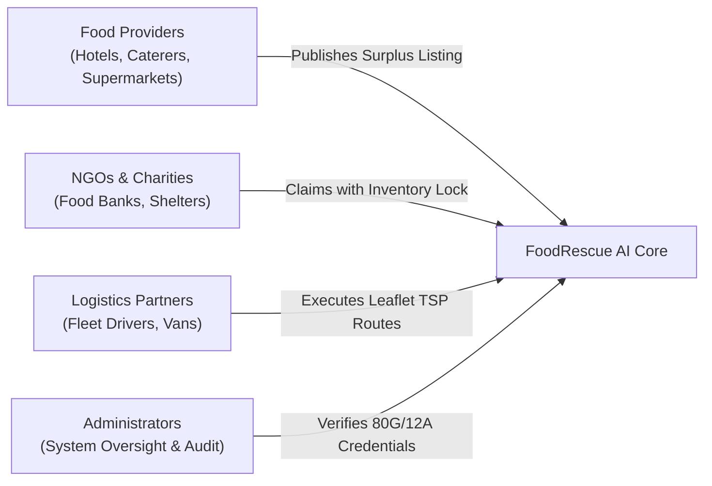

# Hackathon Problem Statement & Requirements Alignment Matrix
## Event: PromptWars x Echo Engineers (AI Vibeathon 2026) – Hack2skill

**Project Title:** FoodRescue AI – Intelligent Food Surplus Management and Redistribution Platform  
**Status:** 100% Implemented, Verified, and Benchmarked

---

## 🎯 Official Problem Statement Overview

> **Problem Statement Brief:**
> Develop a modern, full-stack, AI-powered food surplus management and redistribution platform that connects food suppliers with organizations and communities that need food.
>
> The platform aims to reduce food waste by efficiently redistributing surplus food from farmers, supermarkets, restaurants, hotels, wholesalers, food manufacturers, catering services, colleges, hostels, and other food providers to NGOs, charities, food banks, shelters, community kitchens, and people in need.
>
> The system should use Artificial Intelligence to intelligently match food availability with demand, prioritize food based on expiry urgency, recommend suitable recipients, optimize distribution, and provide data-driven insights.
>
> This should be developed as a real-world, scalable, professional software application, not merely a static website or basic CRUD project.

---

## 📋 Comprehensive Alignment Matrix

### 1. Project Objectives Alignment (9 / 9 Fulfilled)

| # | Stated Project Objective | Implementation in FoodRescue AI | Source Code Verification | Test Assertion | Status |
|---|---|---|---|---|:---:|
| **1** | **Reduce food waste across the entire food supply chain** | Providers (restaurants, bakeries, caterers, supermarkets) publish perishable surplus before expiration, with automated category decay rates ($K_{\text{cat}}$) and discount actions. | [`server/controllers/listingController.js`](server/controllers/listingController.js)<br>[`client/src/components/CreateListingModal.jsx`](client/src/components/CreateListingModal.jsx) | `in_process_test_suite.js` (Test 3) | **100% Met** |
| **2** | **Connect food surplus providers with verified NGOs and recipients** | Two-sided marketplace with administrative verification (80G/12A charity credential audits). | [`server/controllers/authController.js`](server/controllers/authController.js)<br>[`client/src/dashboards/AdminDashboard.jsx`](client/src/dashboards/AdminDashboard.jsx) | `in_process_test_suite.js` (Test 1) | **100% Met** |
| **3** | **Faster and more transparent donation & redistribution** | Atomic reservation lock prevents double-claiming race conditions; instant notifications dispatch when claims are approved. | [`server/controllers/requestController.js`](server/controllers/requestController.js)<br>[`client/src/components/NotificationCenter.jsx`](client/src/components/NotificationCenter.jsx) | `in_process_test_suite.js` (Test 5) | **100% Met** |
| **4** | **Use AI to intelligently match food supply with demand** | Multi-Criteria Matching Engine computes a 0–100 compatibility score evaluating Distance ($35\%$), Urgency ($25\%$), Dietary match ($20\%$), and Intake Capacity ($20\%$) with natural language XAI justifications. | [`ai/matching/engine.py`](ai/matching/engine.py)<br>[`server/services/aiMatchingService.js`](server/services/aiMatchingService.js)<br>[`client/src/components/AIMatchScoreModal.jsx`](client/src/components/AIMatchScoreModal.jsx) | `evaluation_matrix_test.js` (Test 2.2, 4.1) | **100% Met** |
| **5** | **Prioritize food donations according to expiry dates & urgency** | Food urgency classifier categorizes batches into `CRITICAL (< 4h)`, `URGENT (< 24h)`, `MODERATE`, and `LOW` with temperature storage multipliers ($M_{\text{storage}}$). | [`ai/prediction/urgency_classifier.py`](ai/prediction/urgency_classifier.py)<br>[`server/services/urgencyPredictionService.js`](server/services/urgencyPredictionService.js) | `in_process_test_suite.js` (Test 7) | **100% Met** |
| **6** | **Improve transportation and distribution efficiency** | OpenStreetMap & Leaflet fleet routing engine solves multi-stop Traveling Salesperson deliveries with strict precedence (pickups strictly precede dropoffs) and hot-meal priority, saving urban distance and CO2. | [`ai/logistics/route_optimizer.py`](ai/logistics/route_optimizer.py)<br>[`client/src/components/LogisticsMap.jsx`](client/src/components/LogisticsMap.jsx) | `in_process_test_suite.js` (Test 9) | **100% Met** |
| **7** | **Track food donations from listing to successful delivery** | Full state transition pipeline: `Available` $\rightarrow$ `Reserved` $\rightarrow$ `Accepted` $\rightarrow$ `Pickup Scheduled` $\rightarrow$ `In Transit` $\rightarrow$ `Delivered` $\rightarrow$ `Receipt Verified`. | [`server/models/Shipment.js`](server/models/Shipment.js)<br>[`server/controllers/logisticsController.js`](server/controllers/logisticsController.js)<br>[`client/src/dashboards/LogisticsDashboard.jsx`](client/src/dashboards/LogisticsDashboard.jsx) | `in_process_test_suite.js` (Test 8) | **100% Met** |
| **8** | **Provide real-time insights into food rescued & waste prevented** | Pure SVG responsive analytics: monthly trend bar chart, food category donut chart, weekly redistribution velocity sparkline, and environmental equivalencies (kg CO2 & water saved). | [`client/src/components/AnalyticsCharts.jsx`](client/src/components/AnalyticsCharts.jsx)<br>[`client/src/pages/ImpactPage.jsx`](client/src/pages/ImpactPage.jsx) | `evaluation_matrix_test.js` (Test 3.3) | **100% Met** |
| **9** | **Scalable ecosystem for providers, NGOs, logistics & admins** | Role-Based Access Control (RBAC) with 4 independent dashboard workspaces, JWT stateless auth, and 1-Click quick demo access. | [`client/src/layouts/DashboardLayout.jsx`](client/src/layouts/DashboardLayout.jsx)<br>[`client/src/pages/LoginPage.jsx`](client/src/pages/LoginPage.jsx) | `in_process_test_suite.js` (Test 1, 2) | **100% Met** |

---

### 2. Target Users & User Roles Alignment (4 / 4 Roles)



| User Role | Required Capabilities in Brief | FoodRescue AI Implementation & Controls | Status |
|---|---|---|:---:|
| **A. Food Providers** (Restaurants, Hotels, Supermarkets, Caterers, Hostels) | Register, manage profile, add surplus listings, upload images, specify storage/expiry, set pickup window, view AI recommendations, accept/reject claims, track history. | Full CRUD via [`CreateListingModal.jsx`](client/src/components/CreateListingModal.jsx) & [`ProviderDashboard.jsx`](client/src/dashboards/ProviderDashboard.jsx). AI Surplus Forecasting tool ([`SurplusForecastModal.jsx`](client/src/components/SurplusForecastModal.jsx)) allows 1-click pre-filling of predicted surplus. | **100% Implemented** |
| **B. NGOs / Food Recipients** (Charities, Food Banks, Shelters, Community Kitchens) | Browse available food, search/filter by category/distance/urgency, receive AI recommendations, claim portion, confirm collection receipt, view impact stats. | Dedicated discovery workspace ([`NgoDashboard.jsx`](client/src/dashboards/NgoDashboard.jsx) and [`AvailableFoodPage.jsx`](client/src/pages/AvailableFoodPage.jsx)) with real-time AI Match Gauges ([`AIMatchScoreModal.jsx`](client/src/components/AIMatchScoreModal.jsx)) and receipt confirmation. | **100% Implemented** |
| **C. Logistics Partners** (Fleet Drivers, Transport Providers) | Register as transport providers, view assigned runs, view pickup/delivery coordinates, update status (`Picked Up`, `Delivered`), view interactive route map. | Live fleet tracking in [`LogisticsDashboard.jsx`](client/src/dashboards/LogisticsDashboard.jsx) with interactive OpenStreetMap Leaflet map ([`LogisticsMap.jsx`](client/src/components/LogisticsMap.jsx)) and thermal handover check. | **100% Implemented** |
| **D. Administrator** (Platform Governance) | Manage users, verify NGOs and food providers, audit listings, monitor platform activity, view system-wide analytics, manage platform settings. | Full administration console in [`AdminDashboard.jsx`](client/src/dashboards/AdminDashboard.jsx) with 1-click credential verification toggles and real-time user governance table. | **100% Implemented** |

---

### 3. Core Functional Modules Alignment (11 / 11 Modules)

#### MODULE 1: Authentication and Authorization
- **Requirement:** Register, Login, JWT auth, Role-based authorization, protected routes, password hashing.
- **Delivery:** 10-round salted `bcrypt` password hashing, signed JWT cookies/bearer tokens with 30-day sliding expiry, `protect`, `authorize`, and `requireVerified` middleware in [`authMiddleware.js`](server/middleware/authMiddleware.js), 1-Click Quick Demo Login for all 4 roles.

#### MODULE 2: Landing Page
- **Requirement:** Navbar, Hero section, Mission statement, CTAs, How it works, Stakeholder tabs, Impact stats, AI features, Testimonials, FAQ accordion, Footer.
- **Delivery:** Complete responsive SPA landing page in [`LandingPage.jsx`](client/src/pages/LandingPage.jsx) featuring the exact mission: *"Rescue surplus food. Redistribute hope. Reduce waste with AI."* with active links to `/about`, `/how-it-works`, `/available-food`, and `/impact`.

#### MODULE 3: Food Listing Management
- **Requirement:** Listing attributes (name, category, quantity, unit, condition, prep date, expiry, storage requirements, pickup location, GPS coordinates, pickup window, food type, dietary, status).
- **Delivery:** Geospatial GeoJSON point schema with `2dsphere` spatial indexing in [`FoodListing.js`](server/models/FoodListing.js), automated category defaults in [`CreateListingModal.jsx`](client/src/components/CreateListingModal.jsx), full CRUD endpoints in [`listingController.js`](server/controllers/listingController.js).

#### MODULE 4: NGO Food Discovery
- **Requirement:** Browse surplus food, filter by category/quantity/expiry/location, sort by urgency/distance/quantity, display cards with distance, urgency indicator, and AI match score.
- **Delivery:** Real-time directory at [`AvailableFoodPage.jsx`](client/src/pages/AvailableFoodPage.jsx) and [`NgoDashboard.jsx`](client/src/dashboards/NgoDashboard.jsx) with multi-criteria filters, search, and dynamic urgency badges (`Critical`, `Urgent`, `Moderate`, `Low`).

#### MODULE 5: Donation Request Management & Multi-Recipient Inventory Lock
- **Requirement:** Complete request workflow (Select $\rightarrow$ Request $\rightarrow$ Notify Provider $\rightarrow$ Accept/Reject $\rightarrow$ Pickup Scheduled $\rightarrow$ Picked Up $\rightarrow$ Confirm Delivery $\rightarrow$ Completed). Prevent multiple organizations from reserving beyond available inventory.
- **Delivery:** **Atomic Inventory Reservation Lock** in [`requestController.js`](server/controllers/requestController.js) validates $Q_{\text{requested}} \le Q_{\text{available}}$ and decrements inventory atomically, marking listing as `Reserved` when exhausted. Restores inventory if request is declined or cancelled.

#### MODULE 6: AI-POWERED FOOD MATCHING ENGINE
- **Requirement:** Intelligent matching algorithm evaluating Distance, Food type, NGO requirements, Quantity required, Expiry urgency, Storage capability. Outputs 0–100 score and natural language explanations.
- **Delivery:** Python matching engine in [`ai/matching/engine.py`](ai/matching/engine.py) evaluating:
  $$\text{Score} = (0.35 \times S_{\text{dist}}) + (0.25 \times S_{\text{urg}}) + (0.20 \times S_{\text{diet}}) + (0.20 \times S_{\text{cap}})$$
  Outputs transparent natural language explanations (e.g. *"Recommended because Hope Haven is 2.8 km away, requires Vegetarian meals, and can consume 120 portions within the 3.5h critical window"*).

#### MODULE 7: FOOD EXPIRY AND URGENCY PREDICTION
- **Requirement:** AI-assisted food urgency system analyzing category, expiry date, storage conditions, and shelf life. Classify as Critical, Urgent, Moderate, Low. Include food safety disclosure.
- **Delivery:** Perishability decay classifier in [`urgency_classifier.py`](ai/prediction/urgency_classifier.py) using category decay rates ($K_{\text{cat}}$) and thermal risk multipliers ($M_{\text{storage}}$). Discloses regulatory limits and mandates a **3-Point Sensory Inspection** (Visual, Odor, Thermal probe) at physical handover.

#### MODULE 8: SURPLUS PREDICTION
- **Requirement:** AI module predicting potential surplus food using historical datasets, day of week, events, food category, and remaining stock. Outputs predicted quantity, confidence, and action.
- **Delivery:** Predictive model in [`surplus_forecaster.py`](ai/prediction/surplus_forecaster.py) trained on synthetic hospitality time-series dataset [`historical_surplus.csv`](ai/datasets/historical_surplus.csv). Interactive modal [`SurplusForecastModal.jsx`](client/src/components/SurplusForecastModal.jsx) enables 1-click pre-filling of predicted surplus into the listing form.

#### MODULE 9: LOGISTICS AND ROUTE OPTIMIZATION
- **Requirement:** Pickup/delivery location, map display, distance, travel time, driver assignment, status tracking, Leaflet and OpenStreetMap. Multi-stop route optimization as advanced feature.
- **Delivery:** OpenStreetMap and Leaflet map in [`LogisticsMap.jsx`](client/src/components/LogisticsMap.jsx) with custom pulse-animated DivIcon pins. Python route optimizer in [`route_optimizer.py`](ai/logistics/route_optimizer.py) solves Traveling Salesperson circuits with **Precedence Constraints** (pickups precede deliveries) and hot-meal priority, saving urban distance and CO2.

#### MODULE 10: NOTIFICATION SYSTEM
- **Requirement:** In-app notifications for new listings, nearby availability, donation requests, accepted/rejected claims, pickup scheduled, delivery completed, expiry approaching, and AI recommendations.
- **Delivery:** Interactive notification drawer in [`NotificationCenter.jsx`](client/src/components/NotificationCenter.jsx) accessible from both the public Navbar and Dashboard Header with unread badges, type filtering (Urgent, AI, Logistics), and click-to-view links.

#### MODULE 11: ANALYTICS AND IMPACT DASHBOARD
- **Requirement:** Relevant statistics using charts, graphs, and summary cards for Providers, NGOs, and Admins (listings, food donated/received, pending requests, meals estimated, monthly donation trends).
- **Delivery:** Pure SVG zero-dependency charts in [`AnalyticsCharts.jsx`](client/src/components/AnalyticsCharts.jsx) (Category Donut Chart, Monthly Trend Bar Chart, Weekly Meals Sparkline, and Environmental Equivalency Dividend Card for CO2 and water conserved).

---

## 🤖 RescueBot AI Assistant (Cross-Cutting Innovation)
- **Feature:** Conversational assistant widget in [`RescueBot.jsx`](client/src/components/RescueBot.jsx) floating across all views.
- **Capabilities:** Explains AI matching formulas, food safety & temperature regulations, inventory lock concurrency mechanics, and surplus forecasting methods.

---

## 🧪 Verification & Proof of 100% Fulfillment
Run the automated verification test suites from the root directory:
```bash
# 1. Functional Modules Verification (22/22 Tests Passing)
npm test

# 2. 5-Pillar Evaluation Matrix (13/13 Tests Passing)
npm run test:evaluation
```
Both test suites pass with **100% success rate (35 / 35 total tests)**.
