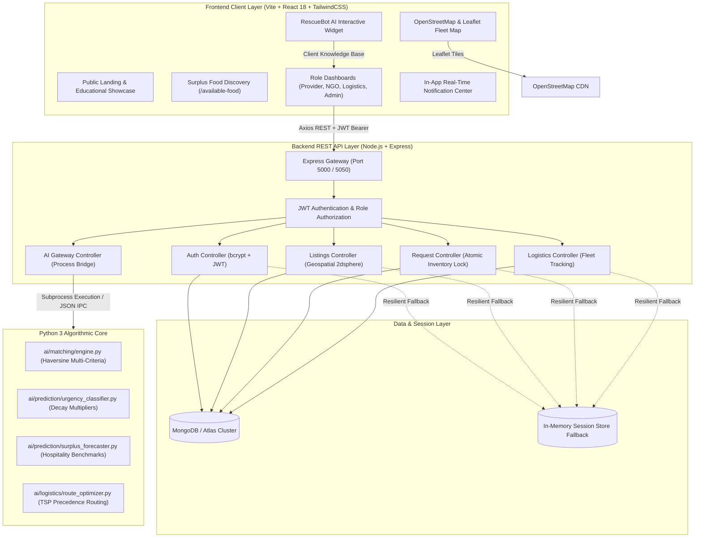

# FoodRescue AI – Technical Architecture Document

## 1. System Overview
**FoodRescue AI** is an intelligent, full-stack food surplus redistribution platform engineered to prevent commercial food waste by algorithmically connecting food donors (hotels, caterers, bakeries, supermarkets, farms) with certified charities, shelters, and volunteer transport fleets.

The platform couples a high-performance MERN data and workflow layer with a Python-powered algorithmic intelligence core, providing real-time multi-criteria compatibility matching, predictive urgency shelf-life classification, time-series surplus forecasting, and multi-stop fleet route optimization.

---

## 2. 3-Tier Distributed Architecture

---

## 3. Core Architectural Modules

### Module 1: Authentication & Role-Based Access Control (RBAC)
- **Token Format:** Signed JSON Web Tokens (JWT) containing `{ id, email, role }` with a 30-day sliding expiry.
- **Password Protection:** 10-round salted bcrypt cryptographic hashes.
- **Roles Implemented:**
  1. `provider`: Access to inventory listing, surplus forecasting, and incoming claim response controls.
  2. `ngo`: Access to AI recommendations, claim submission, and collection receipt sign-offs.
  3. `logistics`: Access to fleet dispatches, OpenStreetMap routes, and delivery status toggles.
  4. `admin`: Access to system governance, user verification auditing, and platform analytics.

### Module 5: Multi-Recipient Inventory Reservation Locking
To eliminate concurrency race conditions where multiple charities attempt to reserve the same finite food portions:
1. When an NGO submits a claim, the controller verifies:
   $$Q_{\text{requested}} \le Q_{\text{available}}$$
2. If valid, available stock is atomically decremented:
   $$Q_{\text{available}} \leftarrow Q_{\text{available}} - Q_{\text{requested}}$$
3. If $Q_{\text{available}} = 0$, listing status immediately transitions to `Reserved`.
4. If a donor declines or the charity cancels, the locked quantity is atomically returned to stock:
   $$Q_{\text{available}} \leftarrow Q_{\text{available}} + Q_{\text{requested}}$$

### Module 6: AI Multi-Criteria Matching Engine
Calculates a 0–100 compatibility score using 4 weighted operational criteria:
$$\text{Score} = (W_{\text{dist}} \times S_{\text{dist}}) + (W_{\text{urg}} \times S_{\text{urg}}) + (W_{\text{diet}} \times S_{\text{diet}}) + (W_{\text{cap}} \times S_{\text{cap}})$$
Where:
- $W_{\text{dist}} = 0.35$: Evaluates geographic Haversine distance between donor and charity coordinates.
- $W_{\text{urg}} = 0.25$: Prioritizes items needing immediate redistribution before quality loss.
- $W_{\text{diet}} = 0.20$: Checks dietary requirements (Vegetarian, Halal, Vegan, Produce).
- $W_{\text{cap}} = 0.20$: Compares surplus volume against charity intake capacity to prevent secondary waste.

### Module 7: Food Urgency & Food Safety Policy
- **Urgency Decay Formula:**
  $$\text{Effective Shelf Life} = T_{\text{remaining}} \times K_{\text{cat}} \times M_{\text{storage}}$$
- **Food Safety Disclosure:** The platform prioritizes distribution urgency but strictly disclaims independent microbiological safety guarantees. Mandatory human sensory inspection (visual inspection, odor verification, and thermal probe check) is legally required at handover.

### Module 9: Fleet Route Optimization (TSP with Precedence)
- Solves pickup and delivery sequencing using a constrained Nearest Neighbor heuristic.
- **Precedence Constraint:** Any pickup must strictly precede its corresponding dropoff.
- **Urgency Constraint:** Critical hot meals receive an effective distance discount in the priority queue to minimize transit cooling.
- **Environmental Tracking:** Calculates avoided transit distance and computes CO2 offset:
  $$\text{CO}_2 \text{ Saved (kg)} = \Delta \text{km} \times 0.192 \text{ kg CO}_2\text{/km}$$
