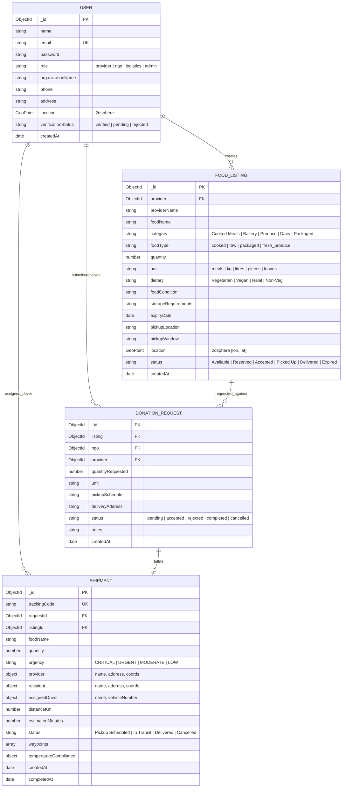

# FoodRescue AI – Database Schema & Data Models

## 1. Overview
The persistence layer of **FoodRescue AI** is built on MongoDB using Mongoose object modeling. It utilizes GeoJSON point structures with `2dsphere` indexing to enable geospatial proximity querying.



---

## 2. Geospatial Indexing
The `location` field on both `User` and `FoodListing` implements the standard GeoJSON specification:

```javascript
location: {
  type: {
    type: String,
    enum: ['Point'],
    default: 'Point'
  },
  coordinates: {
    type: [Number], // [longitude, latitude] per GeoJSON convention
    required: true
  }
}
```

Indexes are created via:
```javascript
foodListingSchema.index({ location: '2dsphere' });
userSchema.index({ location: '2dsphere' });
```

---

## 3. Concurrency & Multi-Recipient Lock
To ensure inventory consistency under concurrent claim requests without table deadlocks:
- MongoDB `$inc` operator is used to decrement `quantity` conditionally:
```javascript
const updatedListing = await FoodListing.findOneAndUpdate(
  { _id: listingId, quantity: { $gte: requestedQty } },
  { 
    $inc: { quantity: -requestedQty },
    $set: { ...(remaining === 0 ? { status: 'Reserved' } : {}) }
  },
  { new: true }
);
```
- If the document fails to match because `quantity < requestedQty`, the transaction aborts with HTTP 400 (`Insufficient remaining inventory`).
